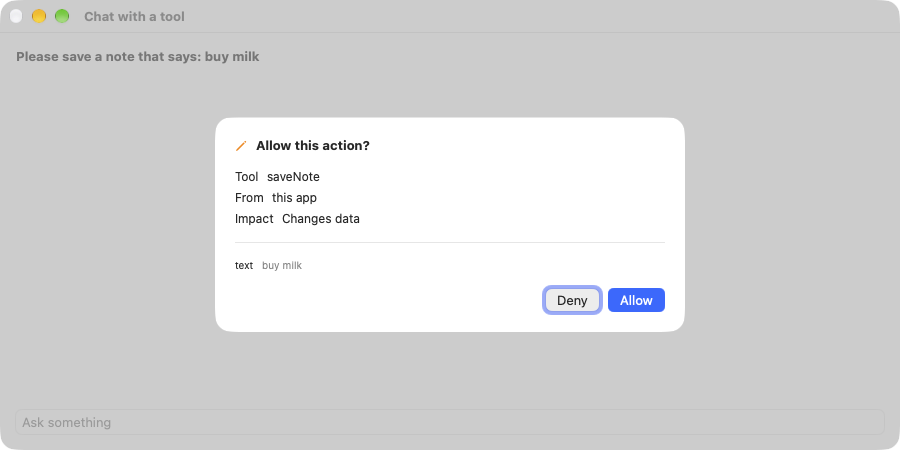

# The tool authorizer: who decides whether a tool call may run

A model cannot do anything to your Mac by itself. It can only write text. When it wants something done (read a file, add
a calendar event, call a server), it writes a *tool call*, which is a request, and your app runs the tool. In the SDK,
every one of those requests passes through one object before the tool runs: the **authorizer**, the code that decides
whether a call may run. The docs sometimes call it *the gate*, because nothing gets past without being checked.

For an app that uses tools, this is the main change in SDK 3.0.

## What changed in 3.0

- **2.3 and earlier:** a session built without an authorizer ran every tool call without asking.
- **3.0:** a session built without an authorizer gets `FailClosedToolAuthorizer`. Calls rated *read* (they only look at
  things) run. Anything that could change data or send it out is refused, and the user is not asked. *Fail closed* means
  that when nothing says yes, the answer is no.

What this means for you: if an app worked on 2.x and has a tool that writes, that tool's calls are now denied until you
pass an authorizer. The model is told `DENIED: <reason>` and carries on without the tool. Nothing you compiled stops
compiling. The behavior changed. [Migrating to 3.0](migrating-to-3.0.md) has the checklist.

## The three ready-made authorizers

| Authorizer | What it does | Use it when |
|---|---|---|
| `FailClosedToolAuthorizer` | Reads run. Everything that could change data or send it out is refused, with no prompt. It is what you get when you pass none. | You haven't decided yet, or your app only reads. |
| `ConfirmingToolAuthorizer` | Applies your rules on every call: it asks the user, or your own policy function, before calls that change things. Each MCP server has its own trust and approval settings. | You are building an app with a user interface. This is the normal choice. |
| `AllowingToolAuthorizer` | Allows every call. It turns the check off, on purpose. | A batch job or a test run where no one is there to ask, and an unasked call can't hurt anyone. |

You can also write your own by implementing `ToolCallAuthorizer`.

## Setting one

```swift
import LocalLMLabSDKCore
import LocalLMLabSDKComponents          // a separate library in the SDK: it draws the "Allow this?" sheet

let confirmations = ToolConfirmationPresenter()                          // how the user is asked
let authorizer = ConfirmingToolAuthorizer(
    channel: confirmations,
    hostTools: .ask(atOrAbove: .mutate, by: .user))                      // ask before your own tools change anything
let session = try lab.makeSession(route: .chat, tools: tools, authorizer: authorizer)

// In your app's root view, so the sheet can appear:
//   ContentView().toolConfirmationSheet(confirmations)
```

`.chat` is a route name that your app declares (`extension RouteName { static let chat: RouteName = "chat" }`).
`lab` and `tools` are the lab and tools you already have. To choose differently, pass `AllowingToolAuthorizer()` for no
checks, or `ConfirmingToolAuthorizer(channel:policy:hostTools:)` with a `policy:` function when a rule, not the user,
should answer.

## What it looks at

Three things feed each decision:

- **Impact.** Every ready-made tool declares how much it can change: `.read`, then `.mutate`, then `.destructive`. A tool
  with no rating counts as `.mutate`. A call can raise its own rating from its arguments, for example a command that
  runs `rm`, but never lower it.
- **Trust and approval, per MCP server.** The server is the unit of trust. An *untrusted* server, which is the default,
  has its own "read-only" and "destructive" labels ignored, so every tool counts as one that may change data. You or the
  user can mark a server trusted, and set when its tools ask first.
- **Who answers.** The user, your policy function, or a standing approval such as "always allow this tool".

## What the user and the model see

- **The user** sees a sheet asking whether the tool may run, which Components' `ToolConfirmationPresenter` draws. It names the tool, where it
  came from and what it can do (here, "Changes data"), shows the arguments, and offers Deny and Allow:

  

- **The model** is told when a call is refused: the result comes back as `DENIED: <reason>`, so the turn continues and
  the model can answer another way. Once the user declines a tool, further calls to it in that turn are refused without
  asking again.
- **A failed question fails closed.** If no one can answer (an app with no way to ask, no policy where one is needed, a
  timeout of 120 seconds by default, or a declined question), the call is denied.

## Every entrance goes through it

The model's own tool calls, the calls an MCP App's interactive view makes, and your own code calling `callMCPTool` all
pass through the session's authorizer. The settings are read on every call, so a change applies to the next call in a
running session.

## What it does not cover

- It is a floor, not a ceiling. It cannot grant access to a tool that isn't in the session's tool list.
- It gates calls the model or a view starts. It does not restrain your own code calling a connector directly, such as
  `CalendarAccess.deleteEvent(...)`.
- It decides whether a call may run. It does not stop a model from being fooled into asking. Other controls cover that:
  [servers start untrusted, changes are held for review, and what the model reads is treated as data](security-overview.md).

## A record of every decision

Each decision goes to the audit stream (`lab.audit.events()`) with who made it: a standing approval, the user, your
policy, or the fail-closed default. If you write your own authorizer, implement `verdict(for:)` so the trail records who
decided. Without it, the trail says only "authorizer".

## If you are upgrading from 2.x

1. Search your code for `makeSession(` calls that pass no `authorizer:`.
2. For each one, pass a `ConfirmingToolAuthorizer` if the app has a user interface, or `AllowingToolAuthorizer()` where no
   one is there to ask and you accept the risk.
3. Show the confirmation sheet in your root view (`.toolConfirmationSheet(confirmations)`), or users will see tools fail.

## Where to read more

- [The security guide for host apps](security-guide-for-hosts.md): its sections "The gate" and "Servers: trust,
  approval and drift".
- [The SDK guide, Tool authorization](sdk-guide.md#tool-authorization-two-levers--which-tools-and-whether-they-ask-first)
  for the settings tables.
- [The assurance case](security-model.md) for what we tested and what we did not.
- [The glossary](glossary.md) for any term above.
