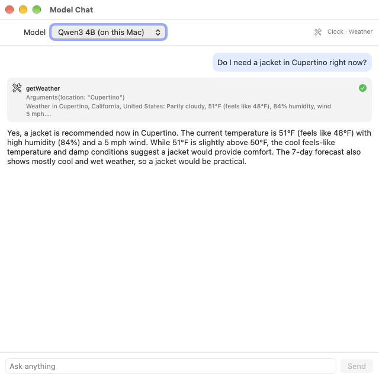

# Model Chat

The smallest app that shows what the SDK is for: **one chat window where you pick the model, and the model can use tools.**
Pick Apple's on-device model or an open-weight model running on this Mac; the chat code is the same for both.



## What it shows

- **Choosing the model is one line.** `lab.models.route(.chat, to: ...)` points the `chat` route at a model; the session is
  built from the route, so nothing else changes. See `Chat.newSession()` in `Sources/ModelChat/ModelChatApp.swift`.
- **Tools.** `ClockTool()` and `WeatherTool()` come with the SDK. The model writes a tool call, the app runs the tool, and
  the result goes back to the model. Each call shows as a row with its arguments, result and state.
- **Loading never downloads.** If the open-weight model isn't on disk, the app says so, `validate` reads the size, and a
  Download button starts `download`. The chat stays off until the model is there.
- **The reply streams.** `session.hostTranscript` is `@Observable`; the view reads it and redraws as the reply arrives.

The two tools only read, so they run as they are. A tool that changes data needs an `authorizer:` on `makeSession`:
see [the tool authorizer](../../docs/tool-authorizer.md).

Requires macOS 27+ on Apple Silicon, Xcode 27 to build. The weather tool asks Open-Meteo for the forecast, so it needs a network connection.

## Run it

```bash
cd examples/model-chat
DEVELOPER_DIR=/Applications/Xcode.app/Contents/Developer swift run ModelChat
```

Apple's model needs Apple Intelligence turned on. For Qwen3 4B, pick it in the model menu and press Download the first time
(about 2 GB).

Try: *Do I need a jacket in Cupertino right now?*
